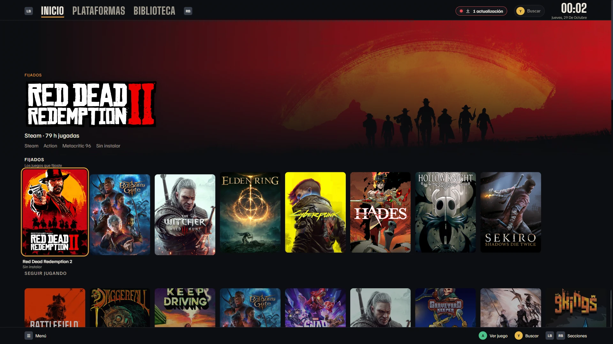
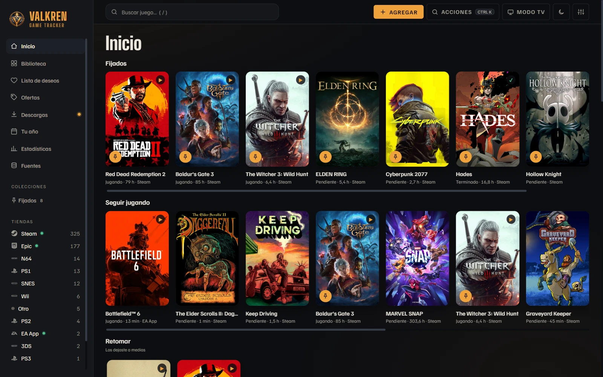
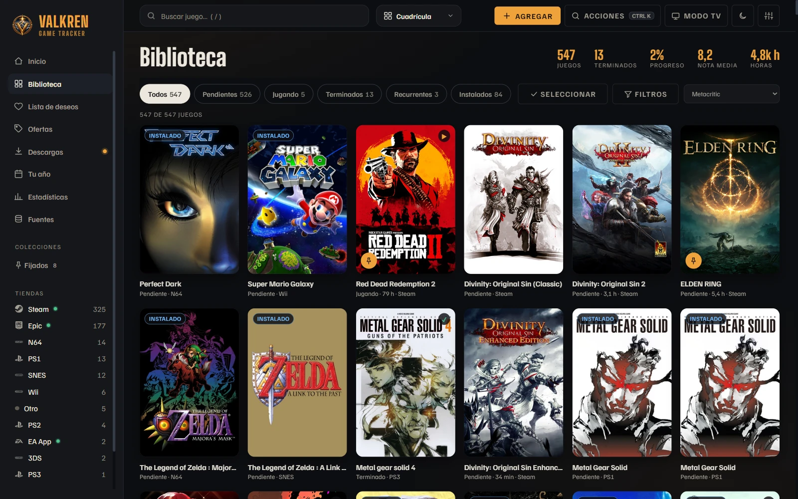
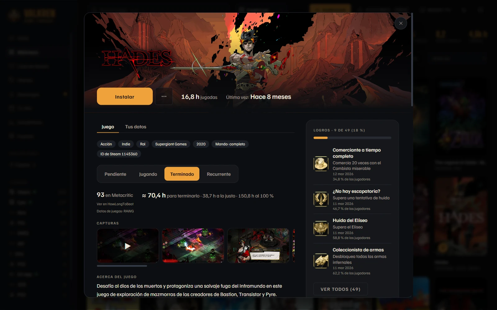
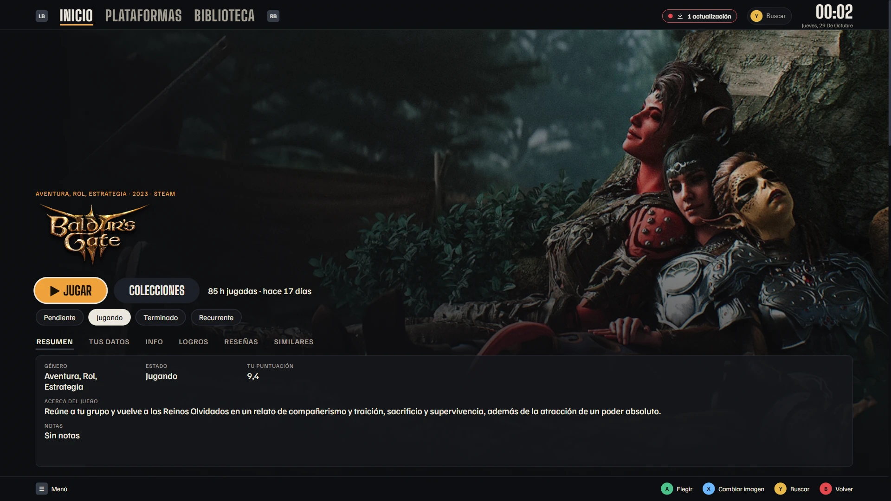
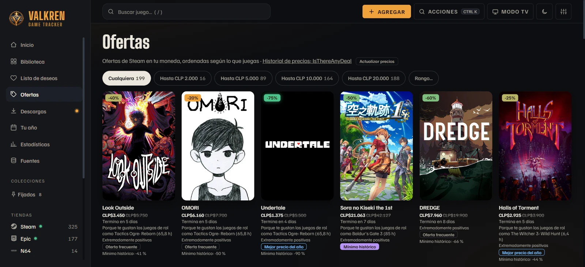

  

<h1 align="center">Valkren</h1>

  Your games from Steam, Epic, Xbox, EA, GOG and RetroBat in one library, 
  with a TV Mode made for playing with a controller from the couch.

  
  
  

  <a href="https://github.com/rmjourdan/valkren-game-launcher/releases/latest"><b>Download for Windows</b></a>
  ·
  <a href="#install">Install</a>
  ·
  <a href="#your-data">Your data</a>
  ·
  <a href="README.md">Español</a>

The screenshots show the app in Spanish; Valkren also runs in English.

## What Valkren is

Valkren is a command center for your game collection on Windows. It finds the games from your stores on its own, gathers them into one library with covers, statuses and play time, and lets you open any of them from one place, with the mouse or with a controller.

It sells nothing and has no servers of its own: it reads what is already on your PC and asks the services you set up directly.

## Features

### One library for all your stores

Steam, Epic Games, Xbox, EA app, GOG and your RetroBat games show up together, with their covers and statuses. Home shows what you were playing, what you left halfway, recommendations from your own library and your pinned games.

Connect your Steam, Epic and Xbox accounts by signing in on each store's own page: your whole library arrives, with the hours each store records, without creating API keys. Xbox brings the games you played in the Xbox app, on Game Pass and on your consoles.

### Sort, filter and group

Mark each game as Backlog, Playing, Finished or Recurring. Filter by store, genre, length or score, sort by hours, by Metacritic or by what you played last, and build your own collections. You can also select several games at once to add them to a collection.

### Everything about each game

The game details bring together screenshots and the trailer, your Steam or RetroAchievements achievements, how long it takes to beat (IGDB, with a link to HowLongToBeat), Steam reviews, similar games from your library and a breakdown of your play time. From there you launch it or install it with its store.

### TV Mode

A full-screen interface for playing from the couch: it works entirely with a controller and adds a video background, the controller's battery level and, if you turn it on, a menu to put the computer to sleep or shut it down. Enter it with the TV Mode button, with F11 or by holding Start on the controller.

### Deals and wishlist

Steam deals in your currency, ranked by what you play, with IsThereAnyDeal's price history to tell a historical low from a deal that comes back often. Your wishlist marks a game when it reaches its lowest price.

### And also

- **Real play time:** when you launch a game from Valkren, it measures the session and adds it to your history.
- **Downloads:** installs in progress and pending updates from your stores on one page.
- **Your Year and Stats:** hours per month, genres, platforms and how your ratings compare with the critics'.
- **Tier list** of your rated games, from S to D.
- **Optional Windows notifications:** install finished, update available, achievement unlocked.
- **Start with Windows**, the system tray, per-game shortcuts and recent games on the taskbar.
- **Game folders:** add games that come from no store by choosing their folder.
- **In English or Spanish:** it follows Windows' language by default, and you can change it in **Settings** or in the first-run setup wizard.

## Install

Requires 64-bit Windows 10 or 11.

1. Open the [latest version](https://github.com/rmjourdan/valkren-game-launcher/releases/latest).
2. Download `Valkren-Setup-<version>.exe` and open it. It installs for your user only, without administrator rights.
3. Windows may show "Windows protected your PC", because the installer is not signed yet. Choose **More info → Run anyway**.

The first time, a setup wizard helps you connect your stores.

## Updates

Valkren checks for new versions when it opens, every hour and when you come back to its window, and downloads them on its own. When one is ready, an **Update** button appears in the top bar; if you don't use it, the update installs when you close the app. You can also check in **Settings → Help and credits**.

## Your data

Valkren has no accounts or servers of its own, and does not collect, sell or share your information.

- **Everything stays on your PC.** Your library, your settings, your keys and your store sessions are stored in `%APPDATA%\game-tracker`; the keys and the sessions, encrypted by Windows. Nothing goes up to a Valkren server, because there is none. Uninstalling Valkren does not delete this data.
- **No usage statistics.** The app sends no telemetry, analytics or reports of what you do.
- **Each key and session goes only to its service.** The Steam, Epic and Xbox accounts, and the free SteamGridDB, IGDB, IsThereAnyDeal or RetroAchievements keys, are used only to ask the service that issued them: Steam's, only Steam. Each person connects their own in **Settings**.
- **Valkren never sees your passwords.** To connect a store account, you sign in on its own page: Steam's or Epic's opens in a separate window, and Microsoft's in your browser. Valkren keeps only the session the store hands it, and deletes it when you choose **Disconnect**. The other features ask for API keys, which you create on each service's page and can delete or change there whenever you want.
- **What does leave your PC:** the requests to those services (your library and your hours in each store, covers, game data, prices), the update check on GitHub and a daily exchange-rate request, to estimate the price of other stores' deals in your currency. Each request carries only what that service needs: its session or its key and, for Steam and RetroAchievements, your Steam ID or your username.

---

This repository publishes Valkren's installers and updates. The source code is private. Game names and images belong to their respective owners.
